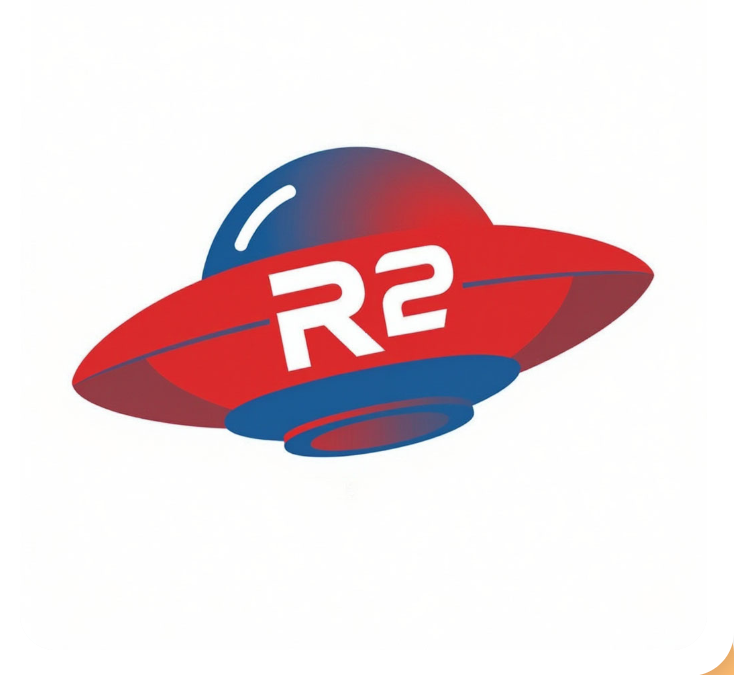

<p align="center">
  
</p>

# R2clone menu — console menu for cloud storage (currently Yandex.Disk)

[](https://github.com/Evgen01101/r2clone-menu/actions/workflows/ci.yml)

A small wrapper around [rclone](https://rclone.org) that makes pulling files from Yandex.Disk to a Windows PC predictable: browse folders, check sizes before downloading, copy with resume, verify results, and read errors — without memorising command-line flags.

<p>
  
  Works through the official <a href="https://yandex.ru/dev/disk-api/">Yandex.Disk API</a>. The logo is used according to the <a href="https://360.yandex.ru/brand/">Yandex 360 brand guidelines</a>.
</p>

It also uploads: a folder or a single file, from a local path into the current cloud folder.

Tested on rclone **v1.75.1**, Windows 10 Pro 22H2, Windows PowerShell 5.1.

Yandex.Disk is fully supported today. Other clouds work through the same rclone, but the access setup (menu item 18) is still Yandex-only — see [Other clouds](#other-clouds).

> Полная документация на русском — [README.md](README.md). This page is a condensed English summary; the Russian README is the reference.

## Why it exists

In 2026 the usual ways to bulk-download from Yandex.Disk on a free plan were closed:

| Method | Status |
|---|---|
| Web UI, "Download folder" | disabled since 11 October 2026 |
| Yandex desktop client | sync requires a Yandex 360 subscription (since 3 June 2026) |
| WebDAV (`https://webdav.yandex.ru`) | paid plans only — `402 Payment Required` on free |
| rclone's built-in OAuth app | Yandex answers `410 GoneError` |
| **Disk REST API with your own OAuth app** | **works on the free plan** — used by this project |

## Requirements

- Windows 10/11, Windows PowerShell 5.1 or newer.
- rclone 1.75+ on `PATH`.
- Free space at least the size of the data you copy.
- A Yandex.Disk account and access to `oauth.yandex.ru`.

## Install rclone

```powershell
winget install --id Rclone.Rclone -e --accept-source-agreements --accept-package-agreements
```

Reopen the console afterwards, then check `rclone version`.

## Set up access to Yandex.Disk

You need **your own** OAuth application: rclone's built-in app is blocked (`410`), and WebDAV is paid-only (`402`).

1. Open `https://oauth.yandex.ru/client/new/` and sign in with the account that owns the files.
2. Choose **"Для авторизации пользователей"** (user authorisation). The "API or debugging" option has no access to user data.
3. Platform **"Веб-сервисы"**; Redirect URI exactly `http://127.0.0.1:53682/`.
4. Page host field may stay empty.
5. Data access: under **"Дополнительные"** add Yandex.Disk and tick `cloud_api:disk.read`, `cloud_api:disk.write`, optionally `cloud_api:disk.info`. Do **not** tick `cloud_api:disk.app_folder` — it limits access to the app's own folder.
6. Save and copy **ClientID** and **Client secret**.

Then create the remote (or use menu item 18):

```powershell
rclone config create ydisk yandex client_id="YOUR_ID" client_secret="YOUR_SECRET" config_is_local=true
rclone lsd ydisk:
```

## Run

Double-click `R2clone_menu.bat`, or:

```powershell
powershell -ExecutionPolicy Bypass -File "<project folder>\R2clone_menu.ps1"
```

| Parameter | Default | Purpose |
|---|---|---|
| `-Remote` | `ydisk` | rclone remote name |
| `-LocalRoot` | empty | forces the local folder for this run; otherwise config, otherwise `<disks folder>\<remote>` |
| `-DryRun` | off | adds `--dry-run`: shows what would be copied, writes nothing |
| `-NoGui` | off | skip folder/file pickers, type paths instead |
| `-Version` | — | print versions and exit |

## Menu

| # | Item | What it does |
|---|---|---|
| 1 | List folders and files | current folder, folders first |
| 2 | Enter folder by number | navigate down |
| 3 | Up one level | navigate up |
| 4 | Disk root | reset to `/` |
| 5 | Size of current folder | file count and total size |
| 6 | Download current folder | `rclone copy` with progress |
| 7 | Download a single file | `rclone copyto` |
| 8 | Download and verify | `copy`, then `check` |
| 9 | Verify local copy | `rclone check --one-way` |
| 10 | Upload folder to Disk | `copy` local folder → `<current>/<folder name>` |
| 11 | Upload file to Disk | `copyto` into the current folder |
| 12 | Local folder for this remote | pick, type or reset; stored in `R2clone_menu.config.json` |
| 13 | Free space and Disk quota | local free space + `rclone about` |
| 14 | Access diagnostics | `rclone lsd` with interpretation |
| 15 | Errors from the log | last 30 `ERROR` lines and the total count |
| 16 | Open log | log in Notepad |
| 17 | Open local folder | current folder in Explorer |
| 18 | ClientID and Client secret | recreate the remote and re-authorise |
| 19 | rclone cheat sheet | common commands and flags |
| 0 / q | Exit | |

Numbering is recalculated after each navigation: folders alphabetically first, then files.

## Local folders and settings

- Per-remote local folder is stored in `R2clone_menu.config.json` next to the script (paths only, no secrets).
- If no record exists, `<disks folder>\<remote>` is used; by default that is the `disks` subfolder of the project folder.
- The folder is created on first use after confirmation.

## How it behaves

- **`copy`, never `sync`.** Nothing is deleted locally or in the cloud; matching names are overwritten by newer versions only.
- **Resume.** Re-running the same item transfers only missing or changed files.
- **Verification.** `rclone check --one-way` reports what is missing locally; expected result is `0 differences found`.
- **Progress and log.** `-P` in the console, full log next to the local folder.
- **Fail-fast.** Press `Ctrl+C` to stop; already copied files stay, the partial one is rewritten next run.

## Troubleshooting

| Symptom | Action |
|---|---|
| `401 Unauthorized` | token revoked or copied incompletely — menu item 18 |
| `402 Payment Required` | WebDAV is paid-only — use the native `yandex` backend |
| `410 GoneError` | rclone's built-in app is blocked — create your own OAuth app |
| `403` / `Insufficient scope` | `cloud_api:disk.read` / `write` not granted |
| `429` / `509` | throttling: `--transfers 2 --checkers 4 --tpslimit 5` |
| Empty console window | `.bat` line endings must be CRLF; check the console font |
| File lands in a wrong folder | items 10–11 use the **current** cloud folder shown in the preview |

Full breakdown (Russian): [docs/troubleshooting.md](docs/troubleshooting.md).

## Limitations

- Free plan: REST API only — WebDAV and the full desktop client are unavailable.
- Photos from the "unlimited" auto-upload are invisible to both API and WebDAV.
- One folder at a time; parallelism is controlled by rclone flags.
- No scheduler built in — use Task Scheduler with a plain rclone command.

## Security

- OAuth token and client secret live in `%APPDATA%\rclone\rclone.conf`, obfuscated but not encrypted.
- The token grants full access to the Disk: never paste it into chats, issues or logs.
- Revoke at `https://id.yandex.ru/security`; changing the Yandex password invalidates all tokens.
- Each user creates their own OAuth application — no shared credentials are shipped.

## Other clouds

Most menu items only use generic rclone commands, so `-Remote gdrive` (or `onedrive`, `s3`) already works for browsing and copying. Item 18 still hardcodes the `yandex` backend type; a `-Type` parameter is planned for 1.3. See the Russian README for Google Drive caveats (custom client, 7-day refresh tokens in Testing mode, Google Docs export).

## License

[MIT](LICENSE). Not affiliated with Yandex or the rclone project; "Yandex.Disk" and "rclone" refer to their respective services and projects.
