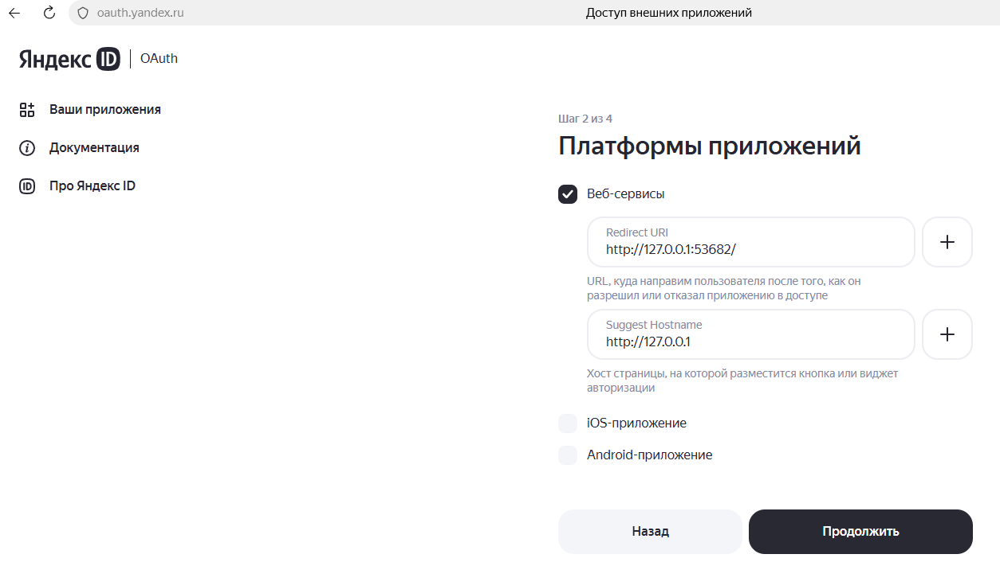
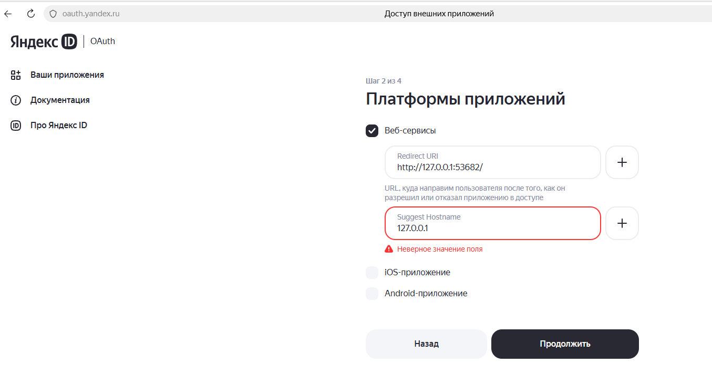
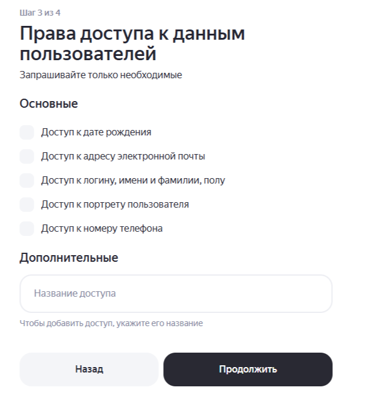
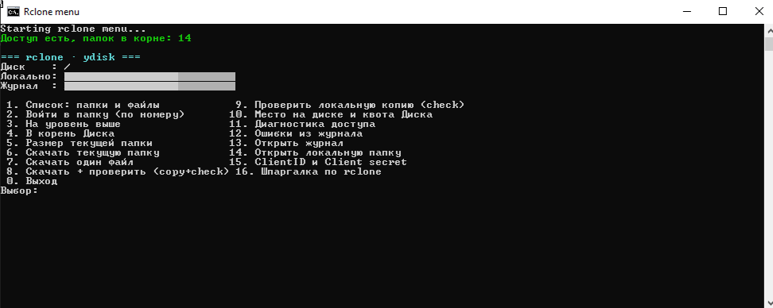
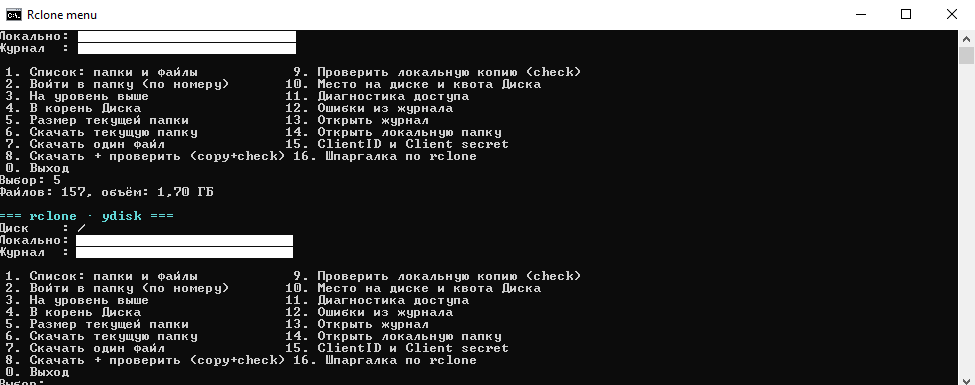

<p align="center">
  
</p>

# R2clone menu — консольное меню для облачных хранилищ (сейчас — Яндекс.Диск)

[](https://github.com/Evgen01101/r2clone-menu/actions/workflows/ci.yml)

Небольшая обёртка над [rclone](https://rclone.org), которая делает выгрузку файлов с Яндекс.Диска на локальный ПК предсказуемой: навигация по папкам, размер до скачивания, копирование с докачкой, сверка результата и разбор ошибок — без запоминания флагов командной строки.

<p>
  
  Работает через официальный API <a href="https://yandex.ru/dev/disk-api/">Яндекс.Диска</a>. Логотип используется по правилам <a href="https://360.yandex.ru/brand/">бренд-системы Яндекс 360</a>.
</p>

Проверено на rclone **v1.75.1**, Windows 10 Pro 22H2, Windows PowerShell 5.1.

Сейчас полностью поддержан Яндекс.Диск. Другие облака работают через тот же rclone, но настройка доступа (пункт 18) пока только для Яндекса — см. раздел [«Другие облака»](#другие-облака-планы-на-будущие-версии).

**English summary:** [README.en.md](README.en.md) · **История версий:** [CHANGELOG.md](CHANGELOG.md) · **Как помочь:** [CONTRIBUTING.md](CONTRIBUTING.md)

## Содержание

- [Зачем это нужно](#зачем-это-нужно)
- [Назначение и границы применения](#назначение-и-границы-применения)
- [Возможности](#возможности)
- [Требования](#требования)
- [Установка rclone](#установка-rclone)
- [Настройка доступа к Яндекс.Диску](#настройка-доступа-к-яндексдиску)
- [Запуск](#запуск)
- [Скриншоты](#скриншоты)
- [Меню](#меню)
- [Как это работает](#как-это-работает)
- [Где что лежит](#где-что-лежит)
- [Ошибки и их причины](#ошибки-и-их-причины)
- [Ограничения](#ограничения)
- [Другие облака (планы на будущие версии)](#другие-облака-планы-на-будущие-версии)
- [Безопасность](#безопасность)
- [Частые вопросы](#частые-вопросы)
- [История изменений](#история-изменений)
- [Лицензия](#лицензия)

## Зачем это нужно

С 2026 года у бесплатного тарифа Яндекс.Диска закрылись привычные способы выгрузки:

| Способ | Состояние |
|---|---|
| Веб-версия, «Скачать папку» | отключено с 11 октября 2026 (скачивание нескольких файлов и папок недоступно) |
| Десктоп-клиент Яндекса | синхронизация только с подпиской Яндекс 360 (с 3 июня 2026) |
| WebDAV (`https://webdav.yandex.ru`) | только на платном тарифе, на бесплатном — `402 Payment Required` |
| Встроенное приложение rclone | Яндекс отвечает `410 GoneError` на любые запросы |
| **REST API со своим OAuth-приложением** | **работает на бесплатном тарифе** — это и использует проект |

Сухой остаток: чтобы забрать папку целиком без подписки, нужен rclone с собственным OAuth-приложением, а это меню избавляет от ручной работы с ним.

## Назначение и границы применения

Приложение работает только с файлами того аккаунта, который вы авторизовали, и предназначено для резервного копирования и переноса собственных данных.

- **Только свой аккаунт.** Чужие аккаунты не поддерживаются: нет импорта токенов, обхода авторизации и доступа к данным третьих лиц (п. 2.8 Условий использования API Яндекс.Диска).
- **Без массового файлообмена.** Приложение не создаёт публичные ссылки, не рассылает файлы и не раздаёт доступ (п. 2.17 Условий использования Яндекс.Диска).
- **Без пересылки третьим лицам.** Файлы идут напрямую между вашим компьютером и Яндексом; телеметрии и собственного сервера у приложения нет.

## Возможности

- Листинг папок и файлов с размерами и датами изменения, навигация по номерам.
- Размер папки до скачивания (файлов и байт) и свободное место на локальном диске.
- Квота Диска (`total` / `used` / `free`).
- Копирование текущей папки, одного файла или всей ветки с прогрессом и журналом.
- Загрузка папки или отдельного файла на Диск (пункты 10–11), с подтверждением и прогрессом.
- Выбор локальной папки для каждого remote с запоминанием в настройках; по умолчанию — `<папка дисков>\<remote>`.
- Автоматическая сверка после копирования (`rclone check --one-way`).
- Разбор журнала: последние ошибки и их количество.
- Ввод/обновление `ClientID` и `Client secret` с пересозданием remote и повторной авторизацией в браузере.
- Диагностика доступа одной кнопкой.
- Шпаргалка по rclone прямо в меню.

## Требования

- Windows 10/11, Windows PowerShell 5.1 (встроенный) или новее.
- rclone 1.75+ в `PATH`.
- Свободное место на локальном диске не меньше объёма выгружаемого.
- Аккаунт Яндекс.Диска и доступ к `oauth.yandex.ru`.

## Установка rclone

Через winget (рекомендуется, права администратора не нужны):

```powershell
winget install --id Rclone.Rclone -e --accept-source-agreements --accept-package-agreements
```

После установки **закройте и откройте консоль заново** — обновится `PATH`. Проверка:

```powershell
rclone version
```

Вручную: скачать `rclone-vX.Y.Z-windows-amd64.zip` с [rclone.org/downloads](https://rclone.org/downloads/), распаковать в отдельную папку (например, `%USERPROFILE%\Tools\rclone`) и добавить её в `PATH`. Это один `rclone.exe`, установка не требуется.

Обновление в дальнейшем: `rclone selfupdate`.

## Настройка доступа к Яндекс.Диску

Нужно **своё** OAuth-приложение. Встроенное приложение rclone заблокировано Яндексом (`410 GoneError`), а WebDAV на бесплатном тарифе недоступен (`402`).

### 1. Создать приложение

1. Открыть `https://oauth.yandex.ru/client/new/` под тем же аккаунтом, где лежат файлы.
2. Тип — **«Для авторизации пользователей»** (вариант «Для доступа к API или отладки» не даёт доступа к данным пользователя и не подойдёт).
3. Название — любое, например `rclone-personal`.
4. Платформы → **«Веб-сервисы»**; Redirect URI строго: `http://127.0.0.1:53682/` (со слэшем на конце).
5. Поле «Хост страницы…» можно оставить пустым (при отказе формы — `localhost`).
6. Права доступа: основные (почта, телефон, портрет) не нужны. В разделе **«Дополнительные»** добавить доступ к **Яндекс.Диску** и отметить:
   - `cloud_api:disk.read` — чтение всего Диска;
   - `cloud_api:disk.write` — запись в любом месте;
   - `cloud_api:disk.info` — информация о квоте (необязательно).
   - `cloud_api:disk.app_folder` **не отмечать**: доступ ограничится служебной папкой приложения, ваши папки видны не будут.
7. Сохранить и скопировать **ClientID** и **Client secret**.

Шаг 2 — платформа и Redirect URI. Слева заполнение, которое форма принимает, справа — частая ошибка: значение без схемы `http://` в поле «Хост страницы» отклоняется как «Неверное значение поля».

| Корректное заполнение | Ошибка валидации |
|---|---|
| [](img/reg-app_ya_qauth1-ok.png) | [](img/reg-app_ya_qauth1-error.png) |

Шаг 3 — права доступа к данным. «Основные» галочки не нужны, доступ к Диску добавляется через раздел «Дополнительные».

[](img/reg-app_ya_qauth3.png)

### 2. Подключить remote

Через меню (пункт 18) или командой:

```powershell
rclone config create ydisk yandex client_id="ВАШ_CLIENT_ID" client_secret="ВАШ_CLIENT_SECRET" config_is_local=true
```

Откроется браузер — нажать «Разрешить». Проверка:

```powershell
rclone lsd ydisk:
```

Список папок Диска означает, что всё настроено.

## Запуск

Три равноценных способа — выбирайте любой. Права администратора не нужны.

**1. Двойной клик** по `R2clone_menu.bat` в папке проекта — самый простой вариант.

**2. Из консоли** в папке проекта:

```powershell
.\R2clone_menu.bat
```

**3. Напрямую скриптом**, если батник не нужен:

```powershell
powershell -ExecutionPolicy Bypass -File ".\R2clone_menu.ps1"
```

Батник делает три вещи: переключает кодовую страницу на UTF-8 (иначе русские имена файлов превращаются в мусор), переходит в свою папку и запускает скрипт с обходом политики выполнения только для этого запуска. Если PowerShell завершится с ошибкой, окно не захлопнется — будет пауза с кодом возврата.

Параметры скрипта:

| Параметр | По умолчанию | Назначение |
|---|---|---|
| `-Remote` | `ydisk` | имя remote в конфиге rclone |
| `-LocalRoot` | не задан | на этот запуск принудительно задаёт локальную папку; если пусто — берётся из настроек, иначе `<папка дисков>\<remote>` |
| `-DryRun` | выкл. | добавляет `--dry-run`: показывает, что было бы скачано или загружено, ничего не записывая |
| `-NoGui` | выкл. | не открывать диалоги выбора папки и файла — путь вводится строкой (полезно в терминале без рабочего стола) |
| `-Version` | — | печатает версию программы, PowerShell и rclone, затем выходит |

Примеры:

```powershell
.\R2clone_menu.bat -DryRun                         # примерка: что было бы скачано или загружено
.\R2clone_menu.bat -NoGui                          # без диалогов, путь вводится строкой
.\R2clone_menu.bat -Remote gdrive                  # другой remote
.\R2clone_menu.bat -LocalRoot "<папка дисков>"  # разовая замена локальной папки
.\R2clone_menu.bat -Version                        # версии программы, PowerShell и rclone
```

Проверка готовности: `-Version` печатает строку вида `R2clone menu 1.2.1`, версию PowerShell и строку rclone; если rclone не установлен, так и скажет.

Локальная папка выбирается пунктом 12 и хранится в `R2clone_menu.config.json` рядом со скриптом — там только пути, без токенов. Если записи для remote нет, используется `<папка дисков>\<remote>`; папка создаётся при первом обращении с подтверждением.

Настройки привязаны к папке, из которой запускается скрипт. Если распаковать релизный архив в другое место, там будет своя копия настроек и своя папка дисков — путь придётся задать заново (пункт 12). Практичнее держать одну рабочую копию проекта.

Текущая папка консоли значения не имеет: и батник, и скрипт находят свои файлы относительно собственного расположения, поэтому запускать можно из любого места.


## Скриншоты

| Главное меню | Пункт 5 — размер текущей папки |
|---|---|
| [](img/console_screenshot.png) | [](img/console_screenshot_menu-5.png) |

Слева — стартовый экран: строка диагностики доступа, пути и полное меню. Справа — выполнение пункта 5 в корне Диска: 157 файлов, 1,70 ГБ (клик по картинке открывает её в полном размере).

## Меню

| № | Пункт | Что делает |
|---|---|---|
| 1 | Список: папки и файлы | содержимое текущей папки, сначала папки, затем файлы |
| 2 | Войти в папку (по номеру) | переход по номеру из списка |
| 3 | На уровень выше | подъём на один уровень |
| 4 | В корень Диска | сброс в `/` |
| 5 | Размер текущей папки | число файлов и суммарный объём |
| 6 | Скачать текущую папку | `rclone copy` с прогрессом |
| 7 | Скачать один файл | `rclone copyto`, выбор по номеру |
| 8 | Скачать + проверить | `copy`, затем автоматический `check` |
| 9 | Проверить локальную копию | `rclone check --one-way` (считает хэши, медленно) |
| 10 | Загрузить папку на Диск | `rclone copy`: локальная папка → `<текущая папка>/<имя папки>` |
| 11 | Загрузить файл на Диск | `rclone copyto`: локальный файл → текущая папка |
| 12 | Локальная папка для Диска | выбрать, ввести вручную или сбросить к `<папка дисков>\<remote>`; сохраняется в настройках |
| 13 | Место на диске и квота | свободное место локально + `rclone about` |
| 14 | Диагностика доступа | `rclone lsd` с разбором результата |
| 15 | Ошибки из журнала | последние 30 строк с `ERROR` и общее число |
| 16 | Открыть журнал | журнал в Блокноте |
| 17 | Открыть локальную папку | текущая папка в Проводнике |
| 18 | ClientID и Client secret | пересоздание remote и повторная авторизация |
| 19 | Шпаргалка по rclone | частые команды и флаги |
| 0 / q | Выход | завершение работы |

Нумерация пересчитывается после каждого перехода: папки идут первыми по алфавиту, файлы — после них. Если список устарел, достаточно снова выбрать пункт 1.

В шапке меню для remote типа `yandex` выводится строка «Доступ к Диску: официальный API Яндекса» — указание на используемую технологию, как требует п. 2.4 Условий использования API Яндекс.Диска.

## Как это работает

- **Только `copy`, никогда `sync`.** `copy` докачивает недостающее и ничего не удаляет локально. `sync` удаляет в целевой папке всё, чего нет на Диске, — в меню он не используется, а в шпаргалке помечен как опасный.
- **Докачка.** Повторный запуск того же пункта сверяет файлы по размеру и времени изменения и качает только отсутствующие или изменённые.
- **Сверка.** `rclone check --one-way` сравнивает источник и приёмник по хэшам и сообщает только о том, чего не хватает локально; в конце — `0 differences found`.
- **Прогресс и журнал.** Копирование идёт с `-P` в консоль; полный журнал — в файл, уровень `INFO`. Флаги копирования: `--transfers 4 --checkers 8 --retries 5 --low-level-retries 10 --stats 10s`.
- **Лимит API.** Не больше 40 запросов в секунду (п. 2.2 Условий API): держите `--transfers` и `--checkers` в пределах 8, при ошибках `429`/`509` добавляйте `--tpslimit 5`. Более высокие значения могут привести к временному ограничению доступа.
- **Загрузка (пункты 10–11).** Обратное направление: `copy` из выбранной локальной папки в **текущую** папку Диска, содержимое попадает в подпапку с именем источника; одиночный файл — `copyto` в текущую папку. Перед стартом показываются путь, число файлов и объём, дальше — подтверждение. `copy` не удаляет на Диске ничего, но совпадающие имена перезаписываются более новыми версиями.
- **Кодировки.** Скрипт выставляет `[Console]::OutputEncoding = UTF8`, батник — `chcp 65001`, поэтому русские имена файлов не превращаются в кракозябры.
- **Безопасность данных.** Файлы идут напрямую из Яндекса на ваш диск; никакие сторонние сервисы не задействованы.

## Где что лежит

| Что | Путь |
|---|---|
| Скрипт | `<папка проекта>\R2clone_menu.ps1` |
| Запуск | `<папка проекта>\R2clone_menu.bat` |
| Конфиг rclone | `%APPDATA%\rclone\rclone.conf` |
| Журнал копирования | `<папка дисков>\rclone-copy.log` (дописывается) |
| Настройки (локальные папки) | `<папка проекта>\R2clone_menu.config.json` |
| Локальная копия | `<папка дисков>\<remote>` (как выбирается — раздел «Запуск») |
| Скриншоты и логотип | `<папка проекта>\img\` |

## Ошибки и их причины

Короткая шпаргалка:

| Симптом | Что делать |
|---|---|
| `401 Unauthorized` | токен отозван, выпущен для другого аккаунта или скопирован не целиком — пункт 18 |
| `402 Payment Required` | WebDAV закрыт на бесплатном тарифе — нужен нативный backend `yandex` |
| `410 GoneError` | Яндекс блокирует встроенное приложение rclone — создайте своё OAuth-приложение |
| `403` / `Insufficient scope` | не выданы права `cloud_api:disk.read` / `cloud_api:disk.write` |
| `429` / `509` | троттлинг: `--transfers 2 --checkers 4 --tpslimit 5` |
| Пустая консоль | концы строк `LF` в `.bat`, шрифт без кириллицы, пауза перед первым выводом |
| «Нет такого номера» | версия до 1.1 — обновите `R2clone_menu.ps1` |

Полный разбор — в [docs/troubleshooting.md](docs/troubleshooting.md): доступ и авторизация, запуск, копирование и загрузка, настройки путей, готовые команды диагностики.

## Ограничения

- Бесплатный тариф: WebDAV и полноценный десктоп-клиент недоступны — только REST API (это меню).
- Фото из «безлимитной» автозагрузки не видны ни через API, ни через WebDAV: их нужно сначала перенести в обычную папку.
- Меню работает в одном потоке: одновременно качается одна папка, параллельность внутри — флагами rclone.
- Расписания нет. Для регулярной выгрузки удобнее планировщик задач с прямым вызовом rclone:
  ```powershell
  rclone copy "ydisk:Папка" "<папка дисков>\Папка" --transfers 4 --log-file "<папка дисков>\rclone-copy.log" --log-level INFO
  ```

## Другие облака (планы на будущие версии)

Меню задумано как обёртка над rclone, а не как инструмент только для Яндекса, поэтому большая часть пунктов уже работает с любым remote. Ограничение одно — пункт 18, где тип backend зашит строкой.

### Что работает без изменений

Пункты 1–17 и 19 вызывают универсальные команды rclone (`lsd`, `lsjson`, `size`, `about`, `copy`, `copyto`, `check`) и от облака не зависят. Логика путей, локальной папки и журнала тоже. Привязан к Яндексу только пункт 18.

Если remote уже настроен (`gdrive`, `onedrive`, `s3`, `dropbox`…), достаточно указать его при запуске:

```powershell
R2clone_menu.bat -Remote gdrive
```

Пункт 18 для такого remote использовать нельзя: он создаст remote типа `yandex`. Настройте облако штатно через `rclone config`, а в меню только работайте с ним.

### Что привязано к Яндексу

| Место | Что именно |
|---|---|
| `R2clone_menu.ps1:406` | `rclone config create $Remote yandex …` — тип backend зашит строкой |
| `R2clone_menu.ps1:398` | подсказка отправляет на `oauth.yandex.ru/client/new` |
| Пункт 19 (шпаргалка) | примеры с `ydisk:`, хотя команды универсальны |
| README | разделы про 402/410, WebDAV и тарифы Яндекса к другим облакам не относятся |

### Планируемые изменения (версия 1.3)

1. Параметр `-Type` (по умолчанию `yandex`) и передача его в `config create` — пункт 18 станет пригоден для любого backend.
2. Подсказка по типу: для `drive` — консоль Google Cloud и вариант «без своих ключей», для `yandex` — `oauth.yandex.ru` с тремя scope.
3. Шпаргалка и справка с подстановкой текущего `$Remote` вместо `ydisk:`.
4. Раздел «Другие облака» с готовыми примерами для Google Drive, OneDrive и S3, включая различия в правах и квотах.

### Google Drive: что учесть

- **Своё приложение желательно, но не обязательно.** rclone умеет работать со своим `client_id`; свой нужен из-за квот Google. Клиент в статусе *Testing* выдаёт refresh-токен на 7 дней — для постоянной работы приложение нужно опубликовать и пройти верификацию.
- **Google Docs/Sheets/Slides — не обычные файлы.** У них нет MD5 и прямого содержимого: rclone экспортирует их в `docx`/`xlsx`/`pptx` (флаг `--drive-export-formats`), поэтому размер в пункте 5 может не совпасть с локальным.
- **Лимиты запросов.** `403 rateLimitExceeded` и `userRateLimitExceeded` лечатся теми же флагами: `--transfers 2 --tpslimit 5`, при необходимости `--drive-chunk-size`.
- **Общие диски** подключаются отдельной настройкой (`team_drive` в конфиге), а пункт 13 покажет квоту пользователя, а не общего диска.
- **Сверка (`check`).** Google Drive и OneDrive отдают MD5, сверка идёт по хэшам. У S3 и части S3-совместимых хранилищ хэшей может не быть — тогда rclone сравнивает только размер, и это нормально.
- **Квота (`about`).** Поддерживается не всеми backend'ами (например, S3 и SFTP её не отдают); пункт 13 в этом случае покажет только свободное место на локальном диске.
- **Длинные пути.** Google разрешает имена до 255 байт, Windows — 260 символов на весь путь; глубокая вложенность упадёт уже на локальной стороне.

## Безопасность

- `Client secret` и токен хранятся в `%APPDATA%\rclone\rclone.conf` в обфусцированном (не зашифрованном) виде — файл стоит беречь.
- Токен даёт полный доступ к Диску. Не вставляйте его в переписку, тикеты и логи.
- Отозвать доступ: `https://id.yandex.ru/security` → «Доступ к данным» → удалить приложение. Смена пароля Яндекса аннулирует все токены сразу.
- После разовой выгрузки доступ можно отозвать и удалить remote: `rclone config delete ydisk`.

## Частые вопросы

**Нужна ли подписка Яндекс 360?** Нет, для REST API достаточно бесплатного тарифа.

**Удаляет ли программа что-то на Диске?** Нет. Все операции — чтение; `sync` не используется.

**Что будет, если прервать копирование?** `Ctrl+C` останавливает rclone и сам скрипт. Уже скачанное остаётся, недокачанный файл перезаписывается при следующем запуске.

**Как убедиться, что копия целая?** Пункт 9 (или 8, он проверяет сразу после копирования). Ожидаемый результат — `0 differences found`.

**Можно перенести на другой ПК?** Да: скопировать папку проекта, установить rclone, заново создать remote (своё приложение придётся авторизовать на новом ПК).

**Несколько аккаунтов?** Создайте второй remote (`ydisk2`) и запускайте с `-Remote ydisk2`.

**Как обновить rclone?** `rclone selfupdate`.

## История изменений

Полный список — в [CHANGELOG.md](CHANGELOG.md). Текущая версия — **1.2.1**: атрибуция API Яндекс.Диска в README и в шапке меню, единый стиль путей в документации; возможности 1.2.0 — загрузка файлов и папок, локальные папки, настройки в `R2clone_menu.config.json`.

## Лицензия

Проект распространяется по лицензии [MIT](LICENSE): используйте, изменяйте и распространяйте свободно, сохраняя текст лицензии и указание правообладателя. Программа предоставляется «как есть», без гарантий — выгрузка и загрузка файлов выполняется на ваш риск.

Проект не связан с Яндексом и с командой rclone; «Яндекс.Диск» и «rclone» — обозначения соответствующих сервисов и проектов.
